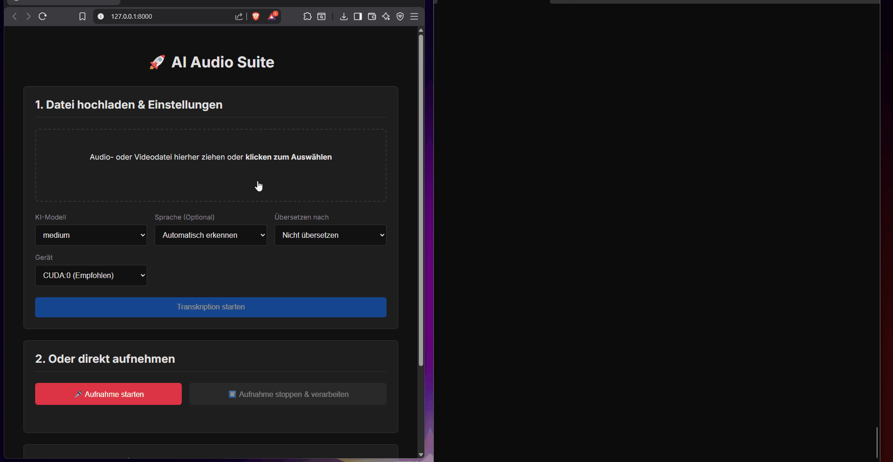

# AI Audio Suite

Eine lokal betreibbare Anwendung zur Transkription, zeitlichen Ausrichtung und optionalen Übersetzung von Audiodateien. Das Portfolio-Projekt verbindet WhisperX, ein Rosetta-Übersetzungsmodell, FastAPI und eine Browseroberfläche.

Ich habe das Projekt umgesetzt und durch praktische Tests und Fehlersuche weiterentwickelt. Mein Fokus liegt auf der Integration der Komponenten, der Einrichtung der Laufzeitumgebung und der iterativen Verbesserung des Verhaltens.



## Funktionsumfang

- Audiodateien hochladen oder im Browser aufnehmen.
- Whisper-Modell und verfügbares Gerät auswählen.
- Hintergrundjobs mit Statusanzeige und Abbruch an Pipeline-Prüfpunkten.
- Zeitstempel mit WhisperX ausrichten.
- Optional segmentweise nach Deutsch, Englisch, Spanisch, Französisch oder Italienisch übersetzen.
- Original, Übersetzung oder beide als SRT/TXT herunterladen.
- Verarbeitungszeiten und Fehler in der Oberfläche anzeigen.

## Architektur

```text
Browser / API-Client
        |
        v
FastAPI: Eingaben prüfen, Datei speichern, Job anlegen
        |
        v
Queue pro Gerät -> Worker pro Gerät
        |
        v
WhisperX -> Alignment -> optionale Rosetta-Übersetzung
        |
        v
Ergebnis im Arbeitsspeicher -> geschützte Abfrage / SRT- und TXT-Export
```

| Bereich | Umsetzung |
| --- | --- |
| API und Upload | `api/jobs.py`, Pydantic-Modelle in `models.py` |
| Jobverarbeitung | `core/transcription.py`: ein Worker pro Gerät, serielle Verarbeitung innerhalb jeder Queue |
| Modellverwaltung | `state.py`: LRU-Cache und gemeinsames Lock für Modell-Ladevorgänge |
| Übersetzung | `translation.py`: Batches, Abbruchprüfungen und Fallback beim Laden ohne Flash Attention |
| Export | `core/exporters.py`: SRT und TXT |
| Oberfläche | `static/`: Upload, Aufnahme, Polling, Ergebnisansicht und Download |

Die Warteschlangen begrenzen parallele Inferenz innerhalb einer einzelnen Serverinstanz. Der Cache begrenzt die Anzahl gespeicherter Modelle, nicht ihren tatsächlichen VRAM-Verbrauch. Große Modelle, andere GPU-Prozesse und Cache-Wechsel können weiterhin Speicherprobleme verursachen.

## Stand und Grenzen

Das Projekt ist ein Prototyp für die praktische Integration von KI-Komponenten. Eine allgemeine Zusage für Ausfallsicherheit oder Produktionsreife ist damit nicht verbunden.

- Jobs und Ergebnisse liegen im Arbeitsspeicher und gehen bei einem Serverneustart verloren. Beendete Jobs können beim Erreichen des Joblimits entfernt werden.
- Mehrere unabhängige Serverprozesse teilen weder Queues noch Jobs. Für diesen Stand eine einzelne Serverinstanz verwenden.
- Abbruch erfolgt an Prüfpunkten; eine bereits laufende Modellberechnung wird nicht sofort unterbrochen.
- Der globale Cache kennt keine aktiven Modellreservierungen zwischen GPUs. Eine Eviction während anderer Jobs ist noch nicht abgesichert.
- Die periodische Temp-Dateibereinigung unterscheidet derzeit nicht zwischen verwaisten Dateien und aktiven Jobs. Sehr lange wartende Jobs können dadurch ihre Eingabedatei verlieren.
- Sprechertrennung, persistente Jobverwaltung, Benutzerkonten, Deployment-Härtung und umfassende Last-/Qualitätstests fehlen.
- Die Oberfläche hält Job-Tokens nur für die aktuelle Seite im Speicher. Nach einem Reload werden vorherige Jobs dort nicht automatisch wiederhergestellt.
- Die Installation ist GPU-/Betriebssystem-abhängig. Die bestehende Requirements-Datei enthält auch Windows-Pakete; ein frisches Setup wurde für dieses Update nicht geprüft.

### Verarbeitung und Zugriff

Transkription und Übersetzung sind für die Ausführung auf dem eigenen Rechner vorgesehen. Modellgewichte und Pakete müssen bei der Einrichtung gegebenenfalls heruntergeladen werden. Lokale Verarbeitung allein belegt keine vollständige Datenschutzkonformität einer späteren Installation.

Jeder Upload liefert einen eigenen `access_token`. Ergebnisabfrage, Download und Abbruch verlangen diesen Token. `/api/v1/jobs` liefert nur die Jobs, die zum übergebenen Token gehören. Der Token ist ein Zugriffsschlüssel für den jeweiligen Job, kein Benutzerkonto.

Bevorzugt wird `Authorization: Bearer <access_token>`; die Browseroberfläche verwendet diesen Header. Bestehende Clients können weiterhin den Query-Parameter `access_token` verwenden. Query-Tokens können in URL-Logs erscheinen. Ein vorhandener Authorization-Header hat Vorrang und wird nicht durch einen Query-Token ersetzt.

Upload und Systemstatus sind weiterhin ohne Anmeldung erreichbar. Für einen Netzwerkbetrieb sind zusätzliche Zugriffsregeln und Transportverschlüsselung erforderlich; das Projekt ist standardmäßig für eine kontrollierte lokale Umgebung gedacht.

### Bisheriger Praxiswert

Im bisherigen Projektbericht wurden ungefähr 3,5 Stunden Audiomaterial in etwa 8 Minuten auf einer RTX 3090 transkribiert und ausgerichtet. Das ist ein eigener berichteter Testwert, kein unabhängig reproduzierter Benchmark. Modell, Audioqualität, Hardware und Konfiguration beeinflussen Laufzeit und Qualität. Dieser Wert wurde beim aktuellen Wartungsupdate nicht erneut gemessen.

## Lokale Einrichtung

Die bestehende Anwendung nutzt Python, PyTorch/CUDA und FFmpeg. Für das bisherige Windows-Setup wurden NVIDIA-GPU-Hardware, CUDA 12.1 und Microsoft C++ Build Tools verwendet.

```powershell
git clone https://github.com/Stanm3n/ai-audio-suite.git
cd ai-audio-suite
python -m venv venv
.\venv\Scripts\Activate.ps1
pip install torch torchvision torchaudio --index-url https://download.pytorch.org/whl/cu121
pip install -r requirements.txt
uvicorn main:app --host 127.0.0.1 --port 8000
```

Oberfläche: `http://127.0.0.1:8000`, API-Dokumentation: `http://127.0.0.1:8000/docs`. Modellgewichte werden bei Bedarf geladen. Der lokale Start bindet ausdrücklich an die Loopback-Adresse.

## API-Beispiele

Die folgenden Beispiele verwenden die Shellsyntax von Bash. Unter Windows kann auch die interaktive API-Dokumentation genutzt werden.

```bash
# Geräte und unterstützte Modelle ansehen
curl "http://127.0.0.1:8000/api/v1/system/status"

# Job erstellen; job_id und access_token aus der Antwort aufbewahren
curl -X POST "http://127.0.0.1:8000/api/v1/transcribe" \
  -F "file=@audio.mp3" -F "model_name=large-v3" \
  -F "language=auto" -F "device=cuda:0" -F "translate_to=de"

# Platzhalter durch die Werte aus der Upload-Antwort ersetzen
curl -H "Authorization: Bearer JOB_TOKEN" \
  "http://127.0.0.1:8000/api/v1/results/JOB_ID"

curl -H "Authorization: Bearer JOB_TOKEN" \
  "http://127.0.0.1:8000/api/v1/jobs"

curl -H "Authorization: Bearer JOB_TOKEN" \
  "http://127.0.0.1:8000/api/v1/results/JOB_ID/download?format=srt&output=translated" \
  -o translated.srt

curl -X POST -H "Authorization: Bearer JOB_TOKEN" \
  "http://127.0.0.1:8000/api/v1/jobs/JOB_ID/cancel"
```

## Regressionstests ohne GPU

Die Tests prüfen Jobzugriffe über die echte FastAPI-Routing-Schicht und Queue-Abschlüsse mit einer echten Python-Queue. Schwere Inferenzbibliotheken werden für diese Tests ersetzt; Modelle werden weder geladen noch heruntergeladen. Die Tests bestätigen keine Transkriptionsqualität oder GPU-Performance.

```powershell
python -m venv .venv-tests
.\.venv-tests\Scripts\Activate.ps1
pip install fastapi==0.119.0 pydantic==2.12.2 pydantic-settings==2.11.0 httpx==0.28.1 python-multipart==0.0.20
python -m unittest discover -s tests -v
```

Der Token-Ablauf der Browseroberfläche wird zusätzlich mit einem kleinen DOM-/Netzwerk-Testfixture geprüft (Node.js erforderlich):

```powershell
node --test tests/frontend-access.test.cjs
```

## Lizenz und Kontakt

Der Anwendungscode steht unter der [MIT-Lizenz](LICENSE). Die Bedingungen verwendeter Modelle gelten unabhängig davon; siehe [Whisper](https://github.com/openai/whisper/blob/main/LICENSE) und die [Gemma-Nutzungsbedingungen](https://ai.google.dev/gemma/terms) für das darauf basierende Rosetta-Modell.

[LinkedIn](https://www.linkedin.com/in/stanislav-eirich/)
